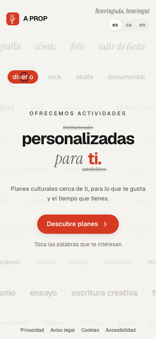
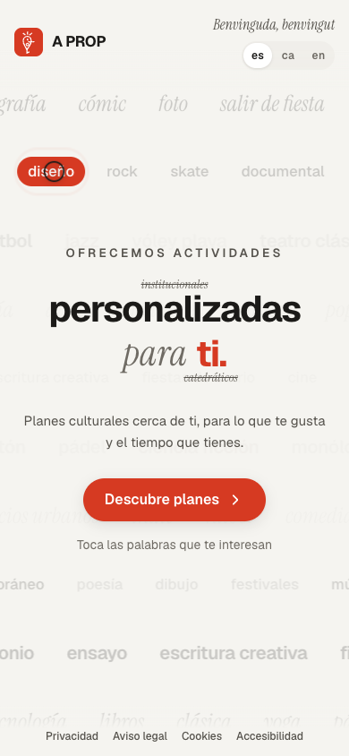
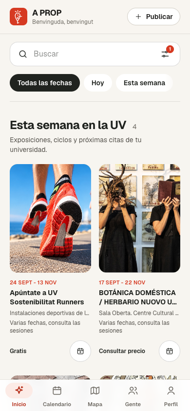
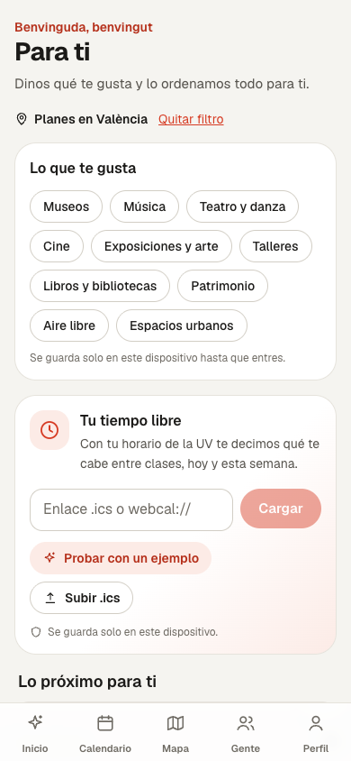
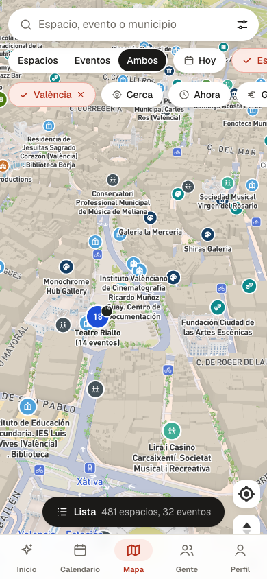
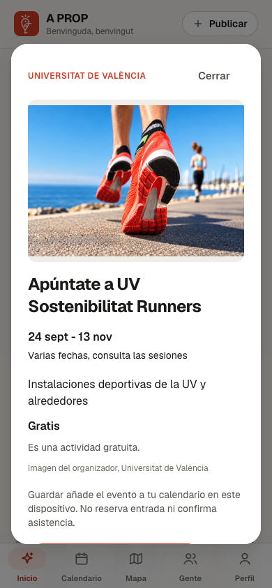
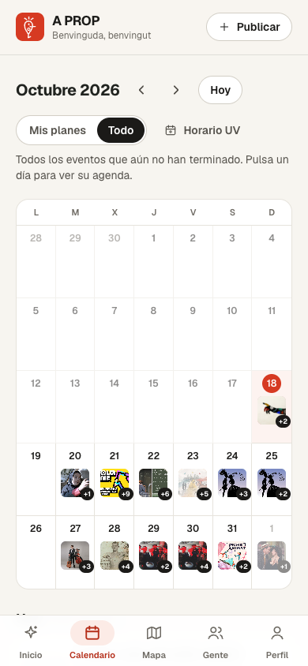

  

<h1 align="center">A PROP</h1>

  <b>Cultura a prop de tu. Culture near you, for what you like and the time you have.</b> 
  <a href="https://apropvlc.com">apropvlc.com</a>

---

A PROP is a no-download web app that shows young people in the Valencian Community the cultural plans around them,
matched to their tastes and their free time, and makes it easy to come back. It was built in a weekend for the
**INCUBA2 hackathon**, answering the "Cultura y Creatividad" challenge set by **Cátedra ESPACIOS** (Universitat de
València, Parque Científico UV and the Spanish Ministry of Culture): *how do we turn local cultural spaces into places
young people feel are their own?*

> This repository is a showcase. The source code lives in a private repository.

## What it does

- **Tap what you're into.** The landing page is a cloud of interests (cinema, rock, photography, theatre...). Tap a few
  words, pick your cities and you get a personal feed. No account, no sign up.
- **Para ti.** Plans ranked by your tastes, with an optional timetable import (`.ics`) so it can suggest what fits
  between your classes.
- **Map of every cultural space.** Theatres, libraries, museums, youth centres and university venues on one map, with
  today's events on each place.
- **One agenda, many sources.** University, faculty and regional agendas merged into a single feed you can filter by
  date, city and type.
- **Your calendar.** Save a plan and it lands in an on-device calendar; export it to Google or Apple Calendar.
- **Spanish, Valencian and English** across the whole app.
- **Privacy first.** It runs without accounts and without tracking: tastes, saved plans and timetable stay on your
  device.

## Screens

  
  
  

  
  
  

## Data

Everything on the map and in the agenda comes from open or public sources, cached at build time (the app never calls
them live):

| Source | What | Records |
|---|---|---|
| PITEC (Cátedra ESPACIOS inventory) | Cultural spaces of the Valencian Community | 2,777 |
| Institut Valencià de Cultura (GVA open data) | Regional agenda | 971 events |
| Universitat de València | University cultural agenda | 67 events |
| UV faculty and service websites | Faculty events, tagged by a small classifier | 345 events |
| OpenStreetMap | Museums | 359 |
| Wikidata | Museums | 205 |

Record counts are from the data snapshot on 18 Oct 2026; a scheduled job refreshes the agendas daily.

## Built with

Next.js 16 (App Router, TypeScript), React 19, Tailwind CSS 4, Mapbox GL JS with a MapLibre and OpenFreeMap fallback,
Supabase (ready for the social features), Vercel and GitHub Actions. Installable as a PWA and packaged for Android as a
Trusted Web Activity.

## Team

| | Who | Built |
|---|---|---|
|  | **Mohamed Benhaddi** ([@benhaddim](https://github.com/benhaddim)) | Product, data pipeline (PITEC, IVC, UV, OSM, Wikidata), map, Para ti, calendar, integration and release |
|  | **Adrian** ([@DonGazpachoWR](https://github.com/DonGazpachoWR)) | Spanish, Valencian and English translation, faculty events scraping and classifier, swipe discovery, city filter, manager mode, accounts, taste survey, mutuals and event groups, legal pages, accessibility contrast |
|  | **Sergio** ([@Serprogramming](https://github.com/Serprogramming)) | Landing hero and tap cue, social proof bubble, Play Store release and production mode |

Thanks to Cátedra ESPACIOS and the Observatori Cultural de la Universitat de València for the challenge and the data.

